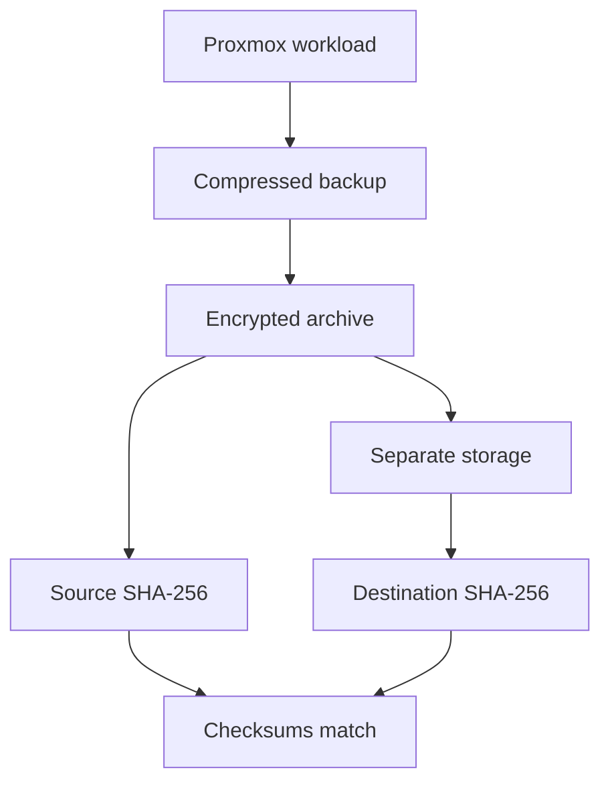

# Backup and Recovery

> **Last documented:** October 2026  
> **Project status:** Daily Home Assistant export and selected isolated VM restoration tested; speech required manual repair; full integration, independent missed-run catch-up and wider recovery remain pending

This document records backup milestones for the HomeLab virtualization workloads and service configuration. It distinguishes the earlier encrypted, integrity-checked workload copies from the current protected guest snapshots, the Home Assistant application backup, and private Hermes configuration safety copies. Live identifiers, filenames, paths, hashes, credentials, and storage details are excluded.

## Verified Backup Scope

Initial backups were created for selected Proxmox virtual-machine and container workloads. Together, these copies established the first protected workload baseline beyond the existing private network-configuration and pre-update host-configuration backups. They do not establish backup coverage for every workload added since that baseline.

After further configuration changes, the virtual-machine workflow was performed again. A new compressed archive was created, encrypted, transferred to separate storage, and checked against its encrypted source. The matching SHA-256 result confirms that a newer protected copy reached the secondary location without detected transfer corruption.

After the Home Assistant-to-Hermes voice integration reached a stable tested state, protected compressed Proxmox snapshot jobs completed successfully for both principal guests. Home Assistant also produced an encrypted local application backup containing its configuration and installed voice applications. These are additional recovery sources; they do not prove recoverability until controlled restoration succeeds. Live guest identifiers, hostnames, storage volumes, resource configuration, and backup filenames remain private.

## Verified Progress

| Stage | Status | Verified result |
| --- | --- | --- |
| Initial virtual-machine backup | **Completed** | A compressed backup of the selected virtual machine was created successfully. |
| Initial container backup | **Completed** | A compressed backup of the selected container was created successfully. |
| Backup encryption | **Completed** | Protected encrypted copies were created before transfer to secondary storage. |
| Secondary copy | **Completed** | The encrypted workload backups were copied away from the primary virtualization host. |
| Source checksum | **Recorded privately** | A SHA-256 checksum was calculated for each encrypted source backup. |
| Destination checksum | **Verified** | Each secondary copy produced the same SHA-256 checksum as its encrypted source. |
| Follow-up virtual-machine cycle | **Completed and integrity-verified** | The manual create, encrypt, transfer, and SHA-256 comparison workflow was repeated successfully after later configuration changes. |
| Home Assistant VM recovery copy | **Created, encrypted, and exported** | A VM-level recovery source was created, protected with private encryption material, and exported to secondary storage. |
| Home Assistant public-key export integrity | **Verified for a selected VM copy** | VMA validation, ciphertext transfer integrity and guided decryption matching the original were tested. Existing-copy automatic runs only verify retained ciphertext integrity. |
| Hermes configuration safety copy | **Created privately** | A copy of the active configuration was retained after the initial voice-path validation. It is not presented as a complete assistant backup. |
| Stable Hermes guest snapshot | **Completed and protected** | A compressed snapshot-mode Proxmox backup completed successfully after the A2A voice path was validated. |
| Stable Home Assistant guest snapshot | **Completed and protected** | A compressed snapshot-mode Proxmox backup completed successfully after the same integration milestone. |
| Home Assistant application backup | **Created and encrypted locally** | The application backup includes Home Assistant configuration and installed voice applications; restoration remains untested. |
| Local working archives | **Temporarily retained** | Unencrypted working archives remain protected on the virtualization host while cleanup and retention handling are finalized. |
| Selected Home Assistant VM restoration | **Tested with manual intervention** | An external encrypted copy was decrypted, hash-checked, VMA-validated, restored and booted in isolation. Application, history and speech checks passed within the scope below; Whisper required a manual tokenizer supplement and service start. Full integration recovery remains unverified. |
| Windows export task | **Daily new-copy run verified** | The time trigger launched a successful new export with VMA and ciphertext checks. Sign-in fallback after the PC was off and overlapping-run suppression were also observed. Independent missed-daily-run catch-up remains unverified. |
| Manual decryption review | **Selected copy verified; monthly policy chosen** | Guided decryption matched the original archive reference. Review is planned monthly and after key or backup-system changes; repeated monthly execution has not yet been demonstrated. |
| Wider retention and coverage | **Pending** | The export task does not establish complete workload coverage, rotation, capacity alerts or disaster recovery. |

## Earlier Virtualization Backup Workflow

The following workflow was verified during the initial baseline and later repeated for the virtual-machine backup:

1. Create a compressed Proxmox backup for the selected workload.
2. Produce an encrypted copy using private encryption material.
3. Calculate a SHA-256 checksum for the encrypted source.
4. Copy the encrypted archive to separate storage.
5. Calculate SHA-256 again at the destination.
6. Confirm that the source and destination checksums match exactly.
7. Retain the local working archive temporarily under explicit protection until cleanup is reviewed.

This diagram represents the verification sequence only. It is not a disclosure of the live storage topology or operational commands.

## Follow-up Backup Validation

The later virtual-machine cycle provides evidence that the documented manual procedure can be executed again after the workload changes. It produced a new encrypted recovery source on storage separate from the virtualization host and confirmed byte-for-byte consistency between the encrypted source and its transferred copy.

This earlier manual repetition does not establish automated scheduling, retention rotation, or recovery readiness. Later task and selected restoration results are recorded separately below. Each protected copy must continue to be checked; one successful restoration does not validate every archive or service.

## Home Assistant VM Recovery Copy

An earlier encrypted Home Assistant VM recovery copy was followed by the separately tested public-key export described below. Results apply to their selected copies; earlier workload checks do not establish current coverage or restoration.

| Recovery source | Recorded result | Remaining validation |
| --- | --- | --- |
| Earlier VM and container archives | Encrypted secondary copies with matching SHA-256 checksums; the manual VM cycle was repeated | Decryption, isolated restoration, startup, and service validation |
| Home Assistant public-key VM export | Daily new-copy task execution, manual decryption and selected isolated VM restoration tested; application and speech checks passed after manual tokenizer repair | Recurring manual review, independently attributed missed-run catch-up, full Assist/Hermes and physical voice tests, automation and data-completeness checks |
| Hermes configuration safety copy | Created privately after the initial voice-path configuration | Protection, integrity comparison, completeness review, and controlled configuration recovery |
| Stable Hermes and Home Assistant guest snapshots | Protected compressed snapshot jobs completed successfully | Isolated restoration, guest startup, and functional validation |
| Home Assistant application backup | Encrypted local backup containing configuration and installed voice applications | Application-level restoration and voice-integration validation |

Uptime Kuma's Home Assistant monitor reported **Up** after saving. That availability result concerns the running service; it provides no validation of the backup copy or its recoverability.

## Home Assistant Public-Key Export

The October continuation added a separate public-key export procedure for an
existing compressed Home Assistant VM backup. Earlier encrypted copies remain
separate recovery sources; their historical results are not reassigned.

### Earlier isolated restoration checks

The prior handoff reports two older Home Assistant VM backups restored into
separate isolated test guests. Both booted, returned HTTP 200 locally and
passed the SQLite integrity check. The last reported state had both test guests
stopped, their network interfaces removed and automatic startup disabled.

These are historical results for those selected older copies, not a fresh test
of the October public-key export or of the live guests. Login, historical data,
integrations, voice and restored automations were not fully validated. No
restoration of Hermes, Tailscale, Uptime Kuma or the whole environment is claimed.

### Source schedule and retention

The historical record describes a weekly snapshot-mode, zstd-compressed
Proxmox backup job for Home Assistant. Its reported keep-last setting did not
match the observed number of retained copies; the cause remains unreviewed.
The Windows task exports the newest available source backup rather than
creating or reconfiguring that source job. Its daily trigger does not prove
daily source-backup creation or correct source retention.

### Encryption and recovery material

A dedicated GPG RSA3072 certification key and RSA3072 encryption subkey were
created with a protected private key. Private-key, public-key and revocation
exports were checked on separate recovery storage intended to remain offline.
Import into a separate GPG home and small-file encryption/decryption were tested,
including ciphertext generated on Proxmox and decrypted on Windows. Sensitive
test key homes were removed after those tests.

A guided export of the actual VM backup validated its VMA archive on Proxmox,
verified transferred ciphertext and decrypted it on Windows. The decrypted
bytes matched the original archive's private SHA-256 reference. This establishes
archive/decryption integrity for that selected copy; the later controlled VM
restoration is recorded separately below. The working Windows key store is
separate from the offline recovery copy. The selected restoration used that
working key store, not a fresh recovery relying only on offline key material.

### Restricted SSH boundary

The dedicated protected SSH key is limited by a forced command and SSH
restrictions to a reviewed backup gateway. An allowed probe succeeded and an
unrelated command was refused. Existing authorization entries and the existing
authorized-keys link were preserved. A full restricted export was tested.

The gateway limits operations and inputs, pins the public recipient, checks
file boundaries and serializes remote work. This constrained privileged backup
helper does not establish comprehensive Proxmox host hardening.

### Verification modes

| Situation | Checks performed | Checks not performed |
| --- | --- | --- |
| New automatic export | Proxmox VMA validation, public-key encryption, transfer, and matching ciphertext SHA-256 in Windows | No automatic decryption or functional restore |
| Existing automatic copy | Local ciphertext compared with its retained SHA-256 reference; recorded source reference read | No fresh source hash, VMA validation, encryption, transfer or decryption |
| Guided export tested | VMA validation, ciphertext integrity and decrypted archive matching the original SHA-256 | No restored-guest, application, integration or voice validation |

Automatic runs never decrypt or store/request the GPG password. Guided
decryption of the newer selected copy matched its original archive reference.
A monthly manual review was chosen, with an additional review after changes
to keys or the backup system. This is a maintenance policy, not proof of
repeated monthly reviews or a newly configured reminder. The daily task has
now created and verified a new encrypted copy without decrypting it.

### Windows task and failure handling

The task has daily and same-user sign-in triggers, with a short sign-in delay.
It uses the user's interactive session and limited privileges, stores no task
password, and does not wake or power on the PC. Missed-run catch-up is configured.
A run after the PC was off was attributed to sign-in; it does not independently
validate catch-up caused by a missed daily trigger.

The launcher checks the destination volume identity, pinned scripts/public key,
and restricted SSH readiness. Logs and JSON reports are stored on the system
disk so a missing destination can still be reported. Only one instance runs.
A started export failure or pending remote cleanup retains a review marker
rather than being blindly retried. Successful runs are quiet.

| Actual test | Confirmed result | Boundary |
| --- | --- | --- |
| Task demand-run | Exporter succeeded and existing ciphertext hash matched | Current-session test |
| Destination disconnected | Local warning received; preflight failure; exporter not started | No export state reset needed |
| Same destination reconnected | Readiness and task run succeeded without resetting state | Existing-copy check |
| Windows restart/sign-in | Task ran without manual launch/key reload and verified ciphertext | The earlier reports do not identify which trigger launched it |
| Daily time trigger | Scheduler history identifies the time trigger; a new copy passed VMA validation and ciphertext SHA-256 verification | Selected scheduled run; no automatic decryption |
| Sign-in after the PC was off | Scheduler history identifies sign-in; the retained ciphertext check and task completion succeeded | Confirms sign-in fallback, not independent missed-daily-run catch-up |
| Overlapping launch attempt | Scheduler refused a second instance while the first was running | Observed overlap suppression; the second attempt's trigger was not established |

These tests establish restricted export availability, a daily timed new-copy
run, sign-in fallback and observed overlap suppression. Independent
missed-daily-run catch-up remains open. The reports do not establish the
exact timing breakdown or guarantee future runs.

The exporter selects the newest retained source backup and cannot recover one
already deleted by retention. The secondary Windows storage is not an off-site
backup. Offline key storage is not an offline copy of the VM archive.

## Selected Isolated Home Assistant VM Restoration

The newer selected public-key VM export was recovered from its external
encrypted copy. It was decrypted using the working Windows key store and
streamed into protected temporary staging on the virtualization host. The
received archive matched the retained original SHA-256 reference and passed
VMA validation before restoration. No unencrypted VM archive was written to
Windows during this transfer.

The archive was restored into a separate test guest with its own disks.
Automatic startup was disabled and the copied network interface was removed
before the first boot. The original service guests remained running in the
reported checks. Results apply to this selected archive and test guest.

| Check | Observed result | Limit |
| --- | --- | --- |
| VM and application startup | The guest booted; Supervisor reached running state and local HTTP returned success | Does not establish that every application or integration recovered |
| Database and configuration | Read-only SQLite structural integrity and the Core configuration check passed; historical records were present | Structural integrity and aggregate records do not prove complete history, statistics or application data |
| Speech dependency | Whisper initially failed because a tokenizer was absent locally and unavailable over the isolated network | The unchanged backup did not demonstrate unattended offline speech recovery |
| Manual speech repair | A separately obtained public tokenizer was hash-checked, parsed and placed alongside the restored model; Whisper became healthy after a manual service start | This supplemented the restored guest; it did not repair the retained backup or the original service guest |
| Direct speech round-trip | Piper generated a synthetic Spanish sentence and Whisper transcribed the expected sentence exactly | Component test bypassing Assist, Hermes and physical voice hardware |
| Restored browser UI | User login, panel access, a selected historical-state view and Piper voice-preview playback succeeded | Selected frontend checks, not complete history or integration validation |
| Stored assistant settings | The Spanish speech engines, voice and Hermes conversation-engine reference were visible | Stored settings are not proof of a successful restored Assist/Hermes conversation |

### Isolated UI access and closure

UI inspection used a temporary restricted QEMU user-network backend with no
production bridge. A host loopback-only web forward was reached through a
local SSH tunnel. The expected guest address, local-only listener and HTTP
response were checked. Sampled outbound TCP connections to host, management
and external targets failed while the guest's local web control succeeded.
These sampled probes support the configured restriction; they are not a
comprehensive test of all protocols or destinations.

After testing, the user closed the browser session and SSH tunnel. The test
guest was shut down, the temporary network arguments were removed, and its
configuration checksum matched the protected pre-UI baseline. The final host
listener check showed no temporary web listener. The test guest was retained
stopped, without a configured network interface and with automatic startup
disabled. Its manual tokenizer addition and test activity remain on its disks;
matching configuration files do not mean unchanged guest-disk contents.

The decrypted host staging archives and transfer files were removed after
individual review. The retained encrypted backup, source archive and test
guest disks were preserved. This cleanup does not establish cleanup or a
retention policy for every earlier working archive.

### Remaining functional boundary

The test establishes selected VM recovery with application and speech checks
after manual intervention. It does not establish an unchanged backup's offline
speech readiness, a full restored Assist/Hermes conversation, physical
microphone or voice-endpoint operation, automation execution, complete data
recovery, Hermes guest or memory restoration, or recovery of the separate
Home Assistant application backup. The earlier live voice-to-Hermes results
must not be reassigned to this isolated restored guest.

## What the Integrity Check Proves

Matching SHA-256 checksums provide evidence that:

- The encrypted file arrived at the secondary location without detected alteration.
- The copied file is byte-for-byte consistent with the encrypted source used for comparison.
- Transfer corruption was not detected during this validation cycle.

The checksum comparison does **not** prove that:

- The encryption passphrase or recovery material is available and correct.
- The encrypted archive can be decrypted successfully in a recovery scenario.
- Proxmox can restore the archive into an isolated target.
- The restored guest boots, obtains the intended network behavior, or starts its services.
- Hermes Agent configuration and persistent memory behave correctly after restoration.

Those outcomes require separate checks, such as the selected controlled restoration above; a checksum match alone is not their evidence.

## Security and Privacy Controls

The earlier encrypted virtualization-backup baseline follows these controls:

- Only encrypted workload archives are copied to secondary storage.
- Encryption credentials and recovery material remain outside the public repository.
- Checksums are compared privately and are not published.
- Backup filenames, timestamps, sizes, paths, IDs, and storage destinations are excluded.
- The public repository contains documentation only, never live backup archives.
- Unencrypted working archives remain on the primary host only temporarily and require explicit cleanup or retention decisions.

The Home Assistant VM recovery copy contains potentially sensitive configuration and security material. Its handling must remain private, and neither its contents nor its metadata should be uploaded to the public repository. The Hermes configuration safety copy has a narrower scope and must not be treated as evidence of complete assistant or persistent-memory recovery.

## Recovery Boundary

The current milestone combines selected export integrity, a daily timed
new-copy task run, guided decryption and an isolated Home Assistant VM
restoration with the limited functional checks above. Manual tokenizer repair
was required. Earlier recovery sources retain their separate scopes.

The monthly decryption-review policy has been chosen; recurring compliance
remains to be demonstrated. Independent missed-daily-run catch-up, source
retention, wider workload coverage and complete functional disaster recovery
remain open. Future drills should test those dependencies and recovery using
offline material, record required manual intervention, validate the intended
services and data, and close temporary access and plaintext staging safely.

## Remaining Work

- Map the current VM, container, and service inventory to its backup scope and recovery dependencies.
- Independently attribute and validate catch-up after a missed daily run, separately from sign-in fallback.
- Carry out the chosen monthly manual decryption review and additional reviews after key or backup-system changes.
- Make the missing speech dependency available through a reviewed recovery procedure and repeat offline speech startup without ad hoc repair.
- Validate restored Assist/Hermes conversation, physical voice hardware and automations in an appropriately controlled test; assess data completeness separately.
- Test recovery using only the intended offline recovery material rather than the working Windows key store.
- Review protection, completeness, and recovery use of the private Hermes configuration safety copy.
- Test the other retained guest snapshots, including Hermes startup and persistent memory; the selected Home Assistant test does not validate those sources.
- Test application-level Home Assistant recovery, including the local speech services and Hermes conversation connector.
- Decide when protected local working archives should be removed.
- Define recurring backup jobs for virtual machines, containers, service configuration, and persistent data.
- Define complete retention, rotation and capacity thresholds; extend failure monitoring beyond the tested local export-task warning.
- Extend the tested Home Assistant export schedule to other required scopes only after reviewing their recovery dependencies and permissions.
- Keep at least one protected copy separate from the primary virtualization host.
- Perform and document controlled restoration tests.
- Review whether an additional offline or off-site copy is appropriate.
- Revalidate recovery procedures after meaningful infrastructure changes.

## Information Intentionally Omitted

This public document does not include:

- VM or container identifiers and names.
- Backup filenames, timestamps, file sizes, storage IDs, paths, drive letters, or destinations.
- Real SHA-256 values or other identifying metadata.
- Encryption commands, passphrases, private keys, recipients, or recovery material.
- Service credentials, internal hostnames, addresses, VLAN identifiers, or DNS records.
- Unredacted terminal output, logs, screenshots, or configuration exports.

These boundaries allow the project to demonstrate practical backup and integrity-validation work without weakening the live recovery process.
