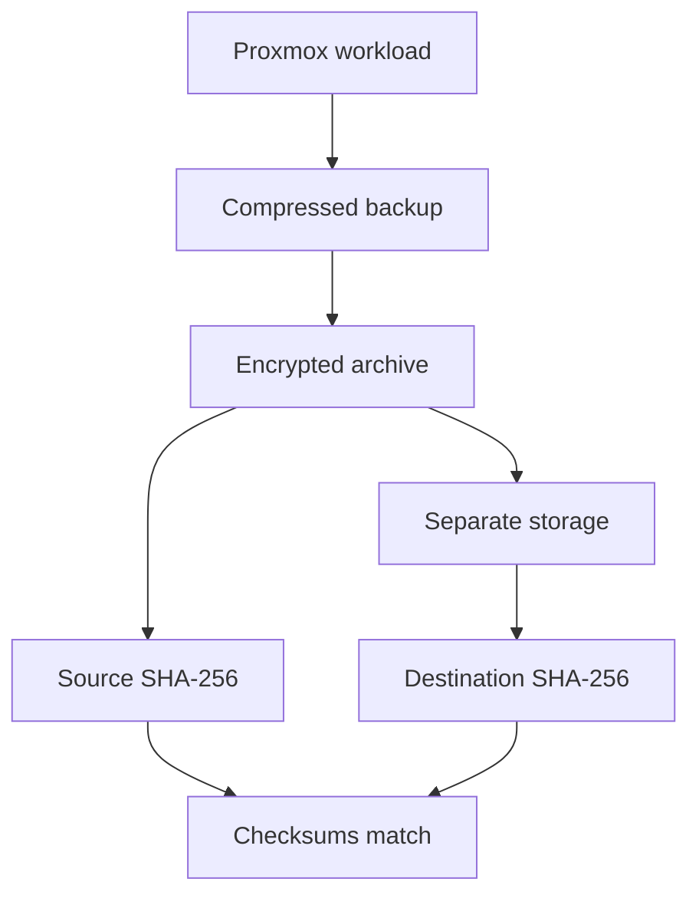

# Backup and Recovery

> **Last documented:** October 2026  
> **Project status:** Four-workload backup coverage recorded; selected isolated recovery and disconnected-copy checks tested; container scheduling and full functional recovery retain explicit limits

This document records backup milestones for the HomeLab virtualization workloads and service configuration. It distinguishes the earlier encrypted, integrity-checked workload copies from the current protected guest snapshots, the Home Assistant application backup, and private Hermes configuration safety copies. Live identifiers, filenames, paths, hashes, credentials, and storage details are excluded.

## Verified Backup Scope

Weekly source jobs are enabled for Home Assistant, Hermes, Tailscale and Uptime Kuma. New weekly VM backups and timed encrypted exports were verified for Home Assistant and Hermes; the new container job awaits its first scheduled-run check. Selected copies of all four workloads have encrypted secondary and disconnected copies. Recovery checks are specific to the selected archives and do not establish full disaster recovery.

Earlier archives, protected guest backups, the Home Assistant application backup and private Hermes configuration safety copies remain distinct recovery sources. The newer tests below do not retroactively validate every earlier archive. Live identifiers, filenames, schedules, locations, resource sizes and cryptographic metadata remain private.

## Verified Progress

| Workload or control | Verified result | Remaining boundary |
| --- | --- | --- |
| Home Assistant VM | New weekly source backup, VMA validation, timed new-copy encrypted export and manual decryption matching the source | The newest archive has not itself been restored; earlier selected isolated recovery required manual speech repair |
| Hermes VM | Protected recovery copy and selected encrypted-copy restoration; subsequent weekly source backup and timed new-copy export; manual decryption | Local HTTP, SQLite structure and readable memory/wiki files do not prove restored conversation or semantic memory retrieval |
| Uptime Kuma container | Fresh protected snapshot backup, decompression/TAR check, encrypted transfer and manual decryption; selected local archive restored | Healthy application, dashboard HTTP, SQLite integrity and aggregate record counts passed after isolated networking adaptations; login, alerts and target connectivity untested |
| Tailscale container | Fresh protected snapshot backup, decompression/TAR check, encrypted transfer and manual decryption; selected local archive restored | Daemon startup, state-file metadata and observed isolation checked; live overlay connectivity and routing untested |
| Windows export tasks | Separate daily tasks and restricted SSH paths for the two VMs; post-restart/sign-in and timed new-copy runs recorded | Container exports remain manual; interactive session, destination, network and SSH readiness are required |
| Missed daily schedule | Hermes task event 114 explicitly identified catch-up; wrapper and exporter succeeded with an existing-copy check | Home Assistant's observed event 119 identifies sign-in; independent missed-schedule recovery remains unproven for that task |
| Disconnected copies | Selected ciphertexts for all four workloads and checksum references/reports were copied to removable storage and compared | A disconnected snapshot requires manual refresh; off-site storage is not established |
| Recovery-key drill | Exported private recovery material imported into a separate temporary GPG home; both selected VM ciphertexts decrypted from removable storage to matching source hashes | No VM was restored in this key drill; container decryption used the working Windows key store |
| Cleanup and retention | Reviewed duplicate ciphertext staging removed after matching destination checks; protected source backups preserved | Complete retention, growth thresholds, failure alerting and recurring maintenance remain ongoing work |

## Earlier Virtualization Backup Workflow

The following workflow was verified during the initial baseline and later repeated for the virtual-machine backup:

1. Create a compressed Proxmox backup for the selected workload.
2. Produce an encrypted copy using private encryption material.
3. Calculate a SHA-256 checksum for the encrypted source.
4. Copy the encrypted archive to separate storage.
5. Calculate SHA-256 again at the destination.
6. Confirm that the source and destination checksums match exactly.
7. Retain the local working archive temporarily under explicit protection until cleanup is reviewed.

This diagram represents the verification sequence only. It is not a disclosure of the live storage topology or operational commands.

## Follow-up Backup Validation

The later virtual-machine cycle provides evidence that the documented manual procedure can be executed again after the workload changes. It produced a new encrypted recovery source on storage separate from the virtualization host and confirmed byte-for-byte consistency between the encrypted source and its transferred copy.

This earlier manual repetition does not establish automated scheduling, retention rotation, or recovery readiness. Later task and selected restoration results are recorded separately below. Each protected copy must continue to be checked; one successful restoration does not validate every archive or service.

## Home Assistant VM Recovery Copy

An earlier encrypted Home Assistant VM recovery copy was followed by the separately tested public-key export described below. Results apply to their selected copies; earlier workload checks do not establish current coverage or restoration.

| Recovery source | Recorded result | Remaining validation |
| --- | --- | --- |
| Earlier VM and container archives | Encrypted secondary copies with matching SHA-256 checksums; the manual VM cycle was repeated | Later selected recovery tests below apply only to their identified sources |
| Home Assistant public-key VM export | Daily new-copy task execution, manual decryption and selected isolated VM restoration tested; application and speech checks passed after manual tokenizer repair | Recurring manual review, independently attributed missed-run catch-up, full Assist/Hermes and physical voice tests, automation and data-completeness checks |
| Hermes configuration safety copy | Created privately after the initial voice-path configuration | Protection, integrity comparison, completeness review, and controlled configuration recovery |
| Stable Hermes and Home Assistant guest snapshots | Protected compressed snapshot jobs completed successfully; later selected guest restorations are recorded below | No recovery claim for every retained snapshot |
| Home Assistant application backup | Encrypted local backup containing configuration and installed voice applications | Application-level restoration and voice-integration validation |

Uptime Kuma's Home Assistant monitor reported **Up** after saving. That availability result concerns the running service; it provides no validation of the backup copy or its recoverability.

## Home Assistant Public-Key Export

The October continuation added a separate public-key export procedure for an
existing compressed Home Assistant VM backup. Earlier encrypted copies remain
separate recovery sources; their historical results are not reassigned.

### Earlier isolated restoration checks

The prior handoff reports two older Home Assistant VM backups restored into
separate isolated test guests. Both booted, returned HTTP 200 locally and
passed the SQLite integrity check. The last reported state had both test guests
stopped, their network interfaces removed and automatic startup disabled.

These are historical results for those selected older copies, not a fresh test
of the October public-key export or of the live guests. Login, historical data,
integrations, voice and restored automations were not fully validated. The later Hermes, Tailscale and Uptime Kuma tests below are separate milestones;
none establishes whole-environment recovery.

### Source schedule and retention

Weekly snapshot-mode source jobs are enabled for both principal VMs and for a combined Tailscale/Uptime Kuma container scope. The VM jobs produced new archives in the observed weekly cycle. The container job was created disabled, inspected, enabled and checked for a calculated next run; its first scheduled execution is still pending validation.

Each job has an explicit bounded keep-last policy. Protected archives remain outside ordinary pruning, explaining why the total retained count can exceed the keep-last setting. The observed Home Assistant cycle pruned one ordinary older archive; the Hermes cycle pruned none. This does not establish every future pruning outcome or sufficient storage indefinitely.

The Windows tasks export the newest retained VM source backup. Their daily triggers do not create daily source backups. Container encryption and external copying currently use a manual procedure. Source storage and thin-provisioned guest-disk storage have separate capacity limits; free space in one does not establish available backup space in the other.

### Encryption and recovery material

A dedicated GPG RSA3072 certification key and RSA3072 encryption subkey were
created with a protected private key. Private-key, public-key and revocation
exports were checked on separate recovery storage intended to remain offline.
Import into a separate GPG home and small-file encryption/decryption were tested,
including ciphertext generated on Proxmox and decrypted on Windows. Sensitive
test key homes were removed after those tests.

A guided export of the actual VM backup validated its VMA archive on Proxmox,
verified transferred ciphertext and decrypted it on Windows. The decrypted
bytes matched the original archive's private SHA-256 reference. This establishes
archive/decryption integrity for that selected copy; the later controlled VM
restoration is recorded separately below. The working Windows key store is
separate from the offline recovery copy. The selected restoration used that
working key store, not a fresh recovery relying only on offline key material.

### Restricted SSH boundary

The dedicated protected SSH key is limited by a forced command and SSH
restrictions to a reviewed backup gateway. An allowed probe succeeded and an
unrelated command was refused. Existing authorization entries and the existing
authorized-keys link were preserved. A full restricted export was tested.

The gateway limits operations and inputs, pins the public recipient, checks
file boundaries and serializes remote work. This constrained privileged backup
helper does not establish comprehensive Proxmox host hardening.

### Verification modes

| Situation | Checks performed | Checks not performed |
| --- | --- | --- |
| New automatic export | Proxmox VMA validation, public-key encryption, transfer, and matching ciphertext SHA-256 in Windows | No automatic decryption or functional restore |
| Existing automatic copy | Local ciphertext compared with its retained SHA-256 reference; recorded source reference read | No fresh source hash, VMA validation, encryption, transfer or decryption |
| Guided export tested | VMA validation, ciphertext integrity and decrypted archive matching the original SHA-256 | No restored-guest, application, integration or voice validation |

Automatic runs never decrypt or store/request the GPG password. Guided
decryption of the newer selected copy matched its original archive reference.
A monthly manual review was chosen, with an additional review after changes
to keys or the backup system. This is a maintenance policy, not proof of
repeated monthly reviews or a newly configured reminder. The daily task has
now created and verified a new encrypted copy without decrypting it.

### Windows task and failure handling

The task has daily and same-user sign-in triggers, with a short sign-in delay.
It uses the user's interactive session and limited privileges, stores no task
password, and does not wake or power on the PC. Missed-run catch-up is configured.
A run after the PC was off was attributed to sign-in; it does not independently
validate catch-up caused by a missed daily trigger.

The launcher checks the destination volume identity, pinned scripts/public key,
and restricted SSH readiness. Logs and JSON reports are stored on the system
disk so a missing destination can still be reported. Only one instance runs.
A started export failure or pending remote cleanup retains a review marker
rather than being blindly retried. Successful runs are quiet.

| Actual test | Confirmed result | Boundary |
| --- | --- | --- |
| Task demand-run | Exporter succeeded and existing ciphertext hash matched | Current-session test |
| Destination disconnected | Local warning received; preflight failure; exporter not started | No export state reset needed |
| Same destination reconnected | Readiness and task run succeeded without resetting state | Existing-copy check |
| Windows restart/sign-in | Task ran without manual launch/key reload and verified ciphertext | The earlier reports do not identify which trigger launched it |
| Daily time trigger | Scheduler history identifies the time trigger; a new copy passed VMA validation and ciphertext SHA-256 verification | Selected scheduled run; no automatic decryption |
| Sign-in after the PC was off | Scheduler history identifies sign-in; the retained ciphertext check and task completion succeeded | Confirms sign-in fallback, not independent missed-daily-run catch-up |
| Overlapping launch attempt | Scheduler refused a second instance while the first was running | Observed overlap suppression; the second attempt's trigger was not established |

These tests establish restricted export availability, a daily timed new-copy
run, sign-in fallback and observed overlap suppression. Independent Home Assistant
missed-daily-run catch-up remains open; later Hermes evidence is separate. The reports do not establish the
exact timing breakdown or guarantee future runs.

The exporter selects the newest retained source backup and cannot recover one
already deleted by retention. The secondary Windows storage is not an off-site
backup. The later disconnected archive-copy and recovery-key drill is recorded separately below.

## Selected Isolated Home Assistant VM Restoration

The newer selected public-key VM export was recovered from its external
encrypted copy. It was decrypted using the working Windows key store and
streamed into protected temporary staging on the virtualization host. The
received archive matched the retained original SHA-256 reference and passed
VMA validation before restoration. No unencrypted VM archive was written to
Windows during this transfer.

The archive was restored into a separate test guest with its own disks.
Automatic startup was disabled and the copied network interface was removed
before the first boot. The original service guests remained running in the
reported checks. Results apply to this selected archive and test guest.

| Check | Observed result | Limit |
| --- | --- | --- |
| VM and application startup | The guest booted; Supervisor reached running state and local HTTP returned success | Does not establish that every application or integration recovered |
| Database and configuration | Read-only SQLite structural integrity and the Core configuration check passed; historical records were present | Structural integrity and aggregate records do not prove complete history, statistics or application data |
| Speech dependency | Whisper initially failed because a tokenizer was absent locally and unavailable over the isolated network | The unchanged backup did not demonstrate unattended offline speech recovery |
| Manual speech repair | A separately obtained public tokenizer was hash-checked, parsed and placed alongside the restored model; Whisper became healthy after a manual service start | This supplemented the restored guest; it did not repair the retained backup or the original service guest |
| Direct speech round-trip | Piper generated a synthetic Spanish sentence and Whisper transcribed the expected sentence exactly | Component test bypassing Assist, Hermes and physical voice hardware |
| Restored browser UI | User login, panel access, a selected historical-state view and Piper voice-preview playback succeeded | Selected frontend checks, not complete history or integration validation |
| Stored assistant settings | The Spanish speech engines, voice and Hermes conversation-engine reference were visible | Stored settings are not proof of a successful restored Assist/Hermes conversation |

### Isolated UI access and closure

UI inspection used a temporary restricted QEMU user-network backend with no
production bridge. A host loopback-only web forward was reached through a
local SSH tunnel. The expected guest address, local-only listener and HTTP
response were checked. Sampled outbound TCP connections to host, management
and external targets failed while the guest's local web control succeeded.
These sampled probes support the configured restriction; they are not a
comprehensive test of all protocols or destinations.

After testing, the user closed the browser session and SSH tunnel. The test
guest was shut down, the temporary network arguments were removed, and its
configuration checksum matched the protected pre-UI baseline. The final host
listener check showed no temporary web listener. The test guest was retained
stopped, without a configured network interface and with automatic startup
disabled. Its manual tokenizer addition and test activity remain on its disks;
matching configuration files do not mean unchanged guest-disk contents.

The decrypted host staging archives and transfer files were removed after
individual review. The retained encrypted backup, source archive and test
guest disks were preserved. This cleanup does not establish cleanup or a
retention policy for every earlier working archive.

### Remaining functional boundary

The test establishes selected VM recovery with application and speech checks
after manual intervention. It does not establish an unchanged backup's offline
speech readiness, a full restored Assist/Hermes conversation, physical
microphone or voice-endpoint operation, automation execution, complete data
recovery, Hermes guest or memory restoration, or recovery of the separate
Home Assistant application backup. The earlier live voice-to-Hermes results
must not be reassigned to this isolated restored guest.

## Hermes Export and Selected Isolated Restoration

Hermes has its own restricted SSH identity, forced-command gateway, state directories, Windows launcher and reports, separate from Home Assistant. An allowed probe succeeded and an unrelated command was refused. Existing Home Assistant authorization remained functional. New automatic exports validate the VMA and ciphertext; retained-copy runs report `ExistingCipherHashVerified`. Neither mode decrypts automatically.

A selected protected Hermes VM backup was validated, encrypted, transferred and manually decrypted to its source SHA-256. Its encrypted external copy was then decrypted into protected temporary host staging, hash-checked, VMA-validated and restored into a separate guest with independent disks, no production network interface and automatic startup disabled.

The restored Docker service initially failed because its published address was absent in the isolated guest. A temporary address on guest loopback and reconnection to the existing internal Docker bridge allowed the application to start and return local HTTP success. These were manual test adaptations; an unchanged unattended recovery is not demonstrated.

Read-only checks passed for the selected SQLite databases. Retained memory and wiki Markdown files were readable and nonempty. No complete restored LLM conversation, semantic memory retrieval, A2A integration or Telegram exchange was tested in this guest. A response from the original live service is separate evidence.

After the checks, the application stopped with exit code zero, the temporary loopback address was removed and the guest was shut down. Plaintext transfer staging was removed after review; source backups, ciphertexts and the isolated test disks were retained.

### Actual timed and missed-schedule execution

The first observed weekly Hermes source job completed successfully. Windows scheduler event 107 identified the daily time trigger, and a new export reported `CreatedCipherHashVerified` with source VMA validation and ciphertext integrity checks. Manual decryption later matched the retained source reference. The equivalent new Home Assistant cycle was also verified. These newer archives were not themselves restored in the earlier drills.

After a later Windows boot, Hermes event 114 explicitly stated that a missed scheduled execution was being recovered. The same scheduler instance completed with code zero, its launcher reported `ExporterSucceeded`, and its exporter verified the existing weekly ciphertext without decrypting. Event 322 rejected an additional launch while that instance was running. Home Assistant instead started through event 119 (user sign-in), then completed with an existing-copy check. Catch-up is therefore demonstrated for the Hermes task in that execution, not independently for Home Assistant.

An earlier Home Assistant export was interrupted by a user-requested Windows restart. The review marker blocked subsequent exports until the launcher/exporter logs, Windows shutdown events and remote state were reviewed. A read-only retained-copy check passed; only the matching marker was archived, and a subsequent task run succeeded. This is a reviewed recovery example, not permission to clear markers automatically or reboot active exports.

## Container Backup and Isolated Restoration

Fresh protected snapshot backups of the dedicated Tailscale and Uptime Kuma containers completed. The selected configurations and included root filesystems were reviewed; Uptime Kuma's Docker data bind mount was confirmed to reside on its included root filesystem. Original service checks succeeded before and after backup. Decompression/TAR structure checks and source SHA-256 references were recorded privately.

Both archives were encrypted with the public recovery recipient before external transfer. Ciphertext hashes matched in Windows, and manual streaming decryption matched each original archive without writing plaintext backups to Windows. Reviewed encrypted host staging and auxiliary GPG files were removed afterward. This does not remove the protected local source archives.

### Uptime Kuma

The selected **local** archive was restored into a new unprivileged container, left stopped, assigned its own disk and given a distinct test label. Automatic startup was disabled and its copied network interface removed before boot. This restore did not consume the encrypted external copy; its decryption was verified separately.

Docker initially could not bind the application's inherited address. A temporary address on container loopback and connection to the existing Docker bridge restored the internal publication. No production bridge interface was added. The restored service became healthy, its local redirect pointed to the dashboard, and that page returned HTTP success.

SQLite was opened read-only with its WAL available, and its integrity check returned `ok`. Counts of users, monitors and notification definitions matched the current original service. Counts do not establish identical record contents, historical completeness, successful login, target reachability or alert delivery. No notifications were intentionally sent as part of the test.

The application stopped with exit code zero, the temporary address was removed and the test container was shut down. The original container remained running. The internal Docker-network attachment and test writes remain on the retained test disk.

### Tailscale

The selected **local** archive was restored into a separate unprivileged test container, initially stopped with automatic startup disabled. Its production network interface was removed before boot; the tunnel-device access was retained. The daemon started, and only loopback and the Tailscale tunnel interface were observed. Neither IPv4 nor IPv6 had a default route in the queried main table. These are observed configuration checks, not exhaustive proof of isolation across every possible path.

The restored state file was present, nonempty, owned by root and restricted to root access. Its contents and private keys were not displayed. A tunnel address and active daemon do not establish current overlay connectivity, authentication acceptance, peer access, subnet routing or gateway operation. No new login, `tailscale up` or logout was performed.

The daemon was stopped and its inactive/dead state verified before orderly shutdown. The test container was retained stopped without a production network interface; the original remained running. No live reconnection with the duplicate restored identity was attempted.

## Disconnected Copies and Recovery-Key Drill

Selected encrypted Home Assistant and Hermes VM archives and their references were copied to a second removable device and compared with the working secondary copies. A protected private recovery-key export was retained there, with its passphrase recorded separately. A temporary Windows GPG home imported that export and successfully decrypted both selected VM archives directly from the removable device; raw output was hashed in memory and matched the original references. No VM restoration was performed in this drill.

Only the temporary imported key home was removed after its own agent was stopped and its path reviewed. The working key store and removable recovery export were retained. This drill establishes decryption using the recovered key, not recovery of a lost Windows installation or the whole environment.

The selected encrypted container archives and their verification reports were subsequently copied to the same removable device and compared byte-for-byte through SHA-256. Their manual decryption used the working Windows key store, not this recovered-key drill. The device was safely ejected and disconnected. The later container-restoration reports are currently retained on working secondary storage; copying those new reports to the disconnected device has not been recorded.

This is a manually refreshed disconnected copy, not continuous replication or demonstrated off-site protection. The passphrase alone is not a private-key backup. Source archives, ciphertexts, private key exports, state files and operational reports remain outside the public repository.

## What the Integrity Check Proves

Matching SHA-256 checksums provide evidence that:

- The encrypted file arrived at the secondary location without detected alteration.
- The copied file is byte-for-byte consistent with the encrypted source used for comparison.
- Transfer corruption was not detected during this validation cycle.

The checksum comparison does **not** prove that:

- The encryption passphrase or recovery material is available and correct.
- The encrypted archive can be decrypted successfully in a recovery scenario.
- Proxmox can restore the archive into an isolated target.
- The restored guest boots, obtains the intended network behavior, or starts its services.
- Hermes Agent configuration and persistent memory behave correctly after restoration.

Those outcomes require separate checks, such as the selected controlled restoration above; a checksum match alone is not their evidence.

## Security and Privacy Controls

The earlier encrypted virtualization-backup baseline follows these controls:

- Only encrypted workload archives are copied to secondary storage.
- Encryption credentials and recovery material remain outside the public repository.
- Checksums are compared privately and are not published.
- Backup filenames, timestamps, sizes, paths, IDs, and storage destinations are excluded.
- The public repository contains documentation only, never live backup archives.
- Retained source archives remain private on the primary host under explicit protection/retention decisions; reviewed transfer staging is removed separately.

The Home Assistant VM recovery copy contains potentially sensitive configuration and security material. Its handling must remain private, and neither its contents nor its metadata should be uploaded to the public repository. The Hermes configuration safety copy has a narrower scope and must not be treated as evidence of complete assistant or persistent-memory recovery.

## Recovery Boundary

The recorded scope now includes enabled weekly source coverage for four workloads, observed new weekly VM cycles, separate daily VM export tasks, guided decryption, disconnected copies, a recovered-key decryption drill and selected isolated restoration checks. Hermes missed-schedule recovery has scheduler and exporter evidence; the corresponding independent Home Assistant case remains open.

The Home Assistant restore required manual speech repair; Hermes and Uptime Kuma required isolated Docker-network adaptations. Tailscale was tested without live overlay reconnection. The container restores used local source archives, whereas the selected earlier VM restores used external encrypted copies. None establishes full integration recovery, every archive's recoverability or unattended disaster recovery.

## Remaining Work

- Verify the container job's first actual scheduled run and its retention outcome; an enabled job and next-run calculation are not execution evidence.
- Independently attribute Home Assistant missed-daily-schedule recovery without mistaking its sign-in trigger for catch-up.
- Carry out the chosen monthly manual decryption reviews and reviews after key or backup-system changes; recurring compliance is not yet demonstrated.
- Decide whether to extend restricted encrypted export automation to the containers; their external exports remain manual.
- Repeat recovery from selected newer archives and distinguish local-archive restore tests from encrypted-copy and recovered-key recovery paths.
- Make offline speech dependencies available through a reviewed procedure and extend Home Assistant checks to restored Assist/Hermes, physical voice, automations and data completeness.
- Validate restored Hermes conversation and semantic memory/wiki behavior; readable files and SQLite integrity alone are insufficient.
- Test Uptime Kuma login, settings equivalence and approved monitor/notification behavior in a controlled environment.
- Assess Tailscale live recovery without concurrently reconnecting a clone of an active identity; gateway and routing behavior remain unverified.
- Test the separate Home Assistant application backup and configuration-only recovery sources.
- Maintain bounded retention, monitor backup-storage growth and establish useful failure/capacity alerts; protected archives accumulate separately.
- Refresh disconnected copies and their new reports through a reviewed copy-and-verify process; assess off-site protection separately.
- Revalidate recovery after meaningful infrastructure changes and retain the scope and manual adaptations in each report.

## Information Intentionally Omitted

This public document does not include:

- VM or container identifiers and names.
- Backup filenames, timestamps, file sizes, storage IDs, paths, drive letters, or destinations.
- Real SHA-256 values or other identifying metadata.
- Encryption commands, passphrases, private keys, recipients, or recovery material.
- Service credentials, internal hostnames, addresses, VLAN identifiers, or DNS records.
- Unredacted terminal output, logs, screenshots, or configuration exports.

These boundaries allow the project to demonstrate practical backup and integrity-validation work without weakening the live recovery process.
